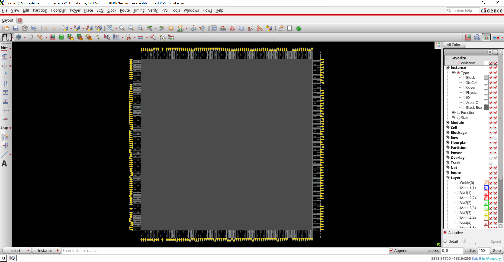
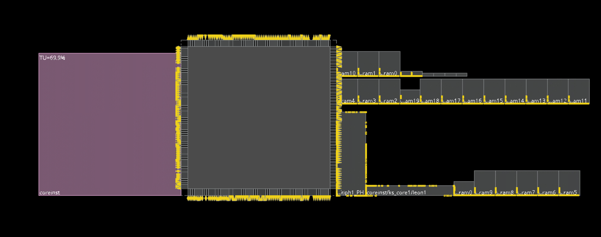
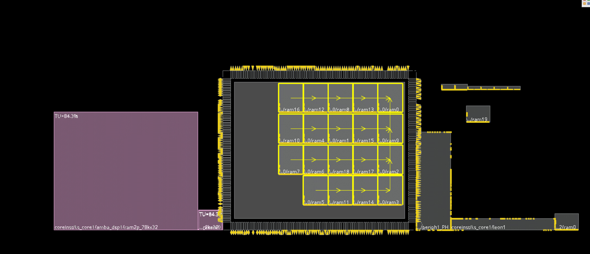
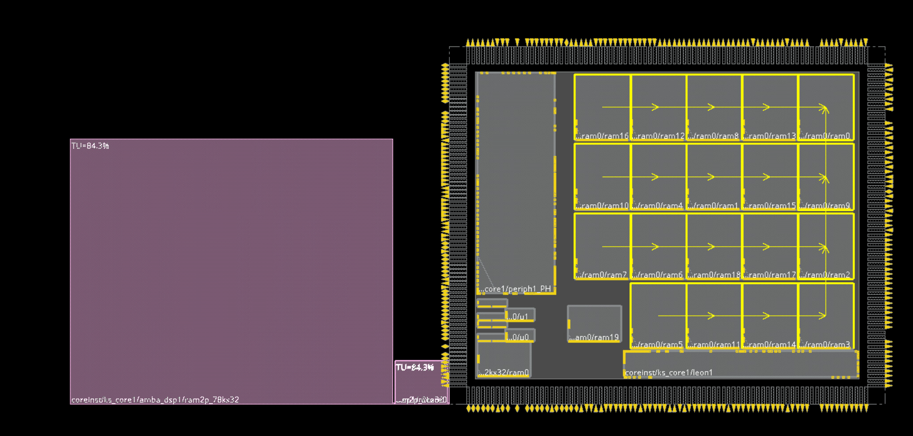
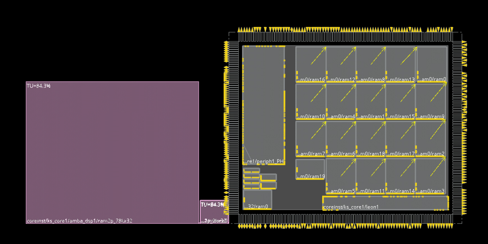
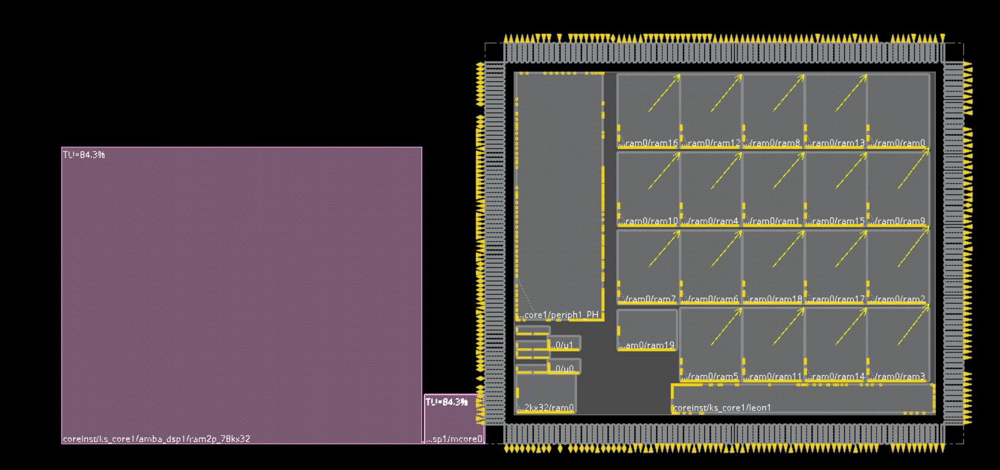
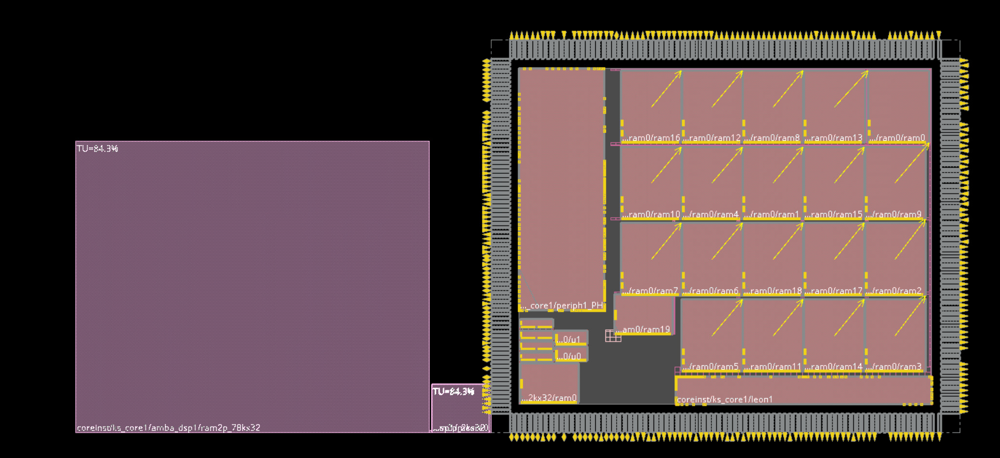
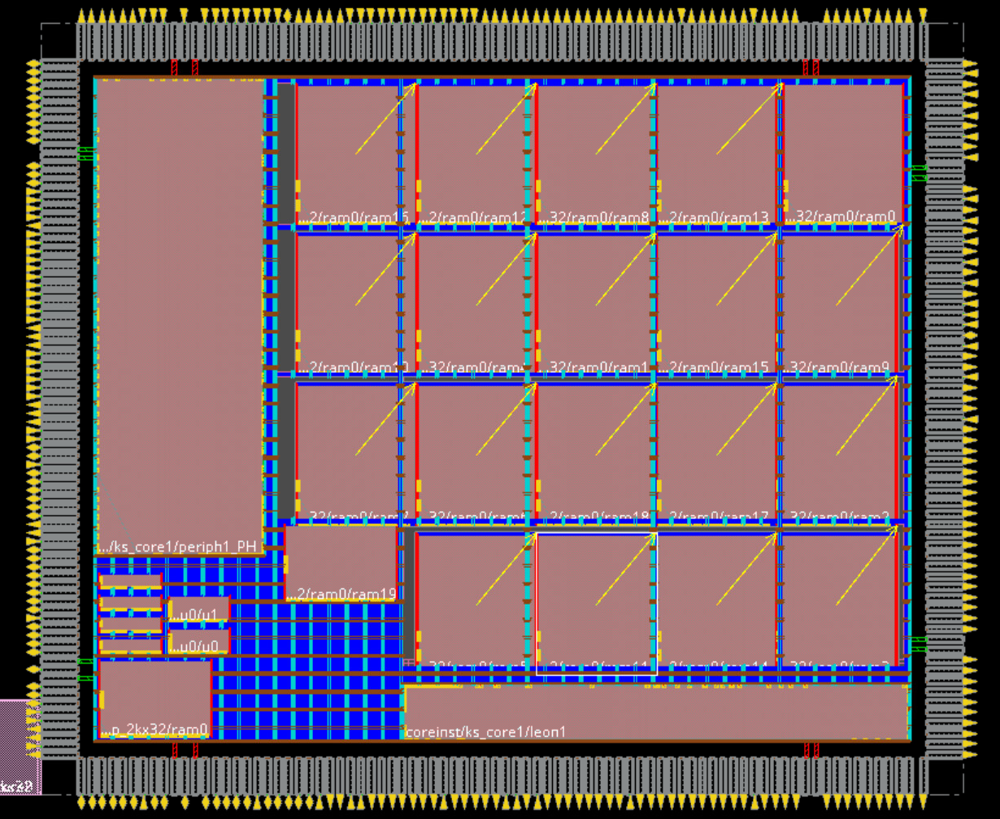
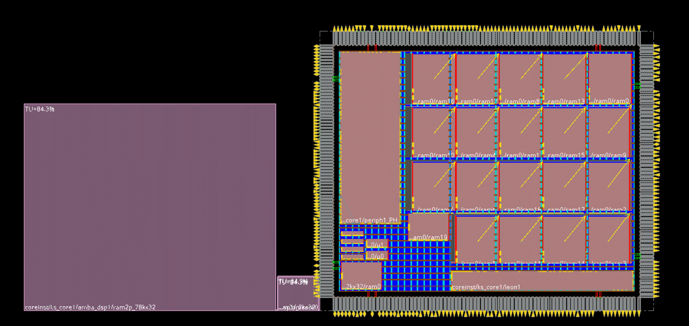
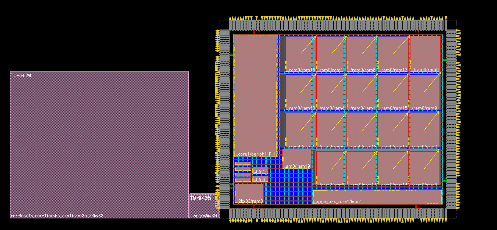

# Nexaris

## Overview

**Nexaris** is a hierarchical ASIC floorplanning and power planning project implemented using the Innovus digital implementation flow. The project focuses on developing a structured floorplan for a macro-intensive SoC design, performing macro organization, channel optimization, placement constraint definition, power grid generation and floorplan refinement prior to detailed placement and routing.

The implementation demonstrates industry-standard physical design practices including:

- Floorplan specification and core sizing
- IO boundary definition
- Hierarchical macro placement
- Relative floorplanning techniques
- Placement constraint management
- Channel optimization
- Placement and routing blockage creation
- Power ring generation
- Power stripe creation
- Power connectivity routing
- Early congestion analysis

The final result is a clean floorplan with organized memory macro placement, optimized routing channels and a robust power distribution network prepared for downstream implementation stages.

---

## Project Objectives

- Define a physically realizable floorplan for a macro-rich design.
- Optimize macro locations to reduce routing complexity.
- Create structured memory arrays using relative placement techniques.
- Minimize congestion through channel management.
- Establish placement constraints and keep-out regions.
- Build a complete power delivery network.
- Prepare the design for placement and routing.

---

# Design Import and Initial Floorplan

The design database was imported together with technology libraries, LEF data, timing views and IO assignments.

The initial imported design contains:

- Core region
- IO ring
- Hierarchical modules
- Memory macros
- Peripheral blocks
- Processor subsystem blocks

### Initial Imported Design



At this stage the floorplan contains:

- Core boundary
- IO pins around the die perimeter
- Logical hierarchy modules
- Unplaced hard macros

---

# Floorplan Specification

A fixed floorplan size was created to provide sufficient area for macro placement and routing resources.

### Floorplan Parameters

| Parameter | Value |
|------------|---------|
| Width | 6250 µm |
| Height | 5150 µm |
| Core Left Margin | 120 µm |
| Core Right Margin | 120 µm |
| Core Top Margin | 120 µm |
| Core Bottom Margin | 120 µm |

The floorplan dimensions establish the die area while maintaining uniform spacing between the core and IO boundaries.

### Floorplan Creation



---

# Macro Planning Strategy

The design contains multiple SRAM and memory structures that dominate the physical layout.

Instead of allowing automatic placement to determine macro locations, the macros were intentionally organized to:

- Reduce long interconnects
- Improve memory locality
- Simplify routing channels
- Improve congestion distribution
- Create predictable routing paths

---

# Relative Macro Placement

A memory array was constructed by selecting the memory instances and arranging them into a structured matrix.

The implementation used relative positioning techniques to maintain:

- Uniform spacing
- Consistent orientation
- Predictable connectivity
- Easy future floorplan resizing

### Memory Array Formation



The memory blocks were organized into a 4 × 5 matrix structure.

Key placement concepts used:

- Reference-based positioning
- Row alignment
- Column alignment
- Fixed macro spacing
- Anchor-based placement

---

# Macro Trace Analysis

Connectivity visualization was used to study communication patterns between memory macros.

This helped identify:

- Highly connected blocks
- Critical communication paths
- Optimal orientation directions
- Routing hotspots

### Connectivity Analysis



The connectivity traces indicate the logical interaction between memory resources and surrounding processing blocks.

This information was used to validate the macro arrangement before committing to final placement.

---

# Hierarchical Macro Placement

After validating connectivity, additional major blocks were positioned.

Important blocks include:

- Processor subsystem
- Peripheral subsystem
- Memory subsystem
- Local memory resources

The placement strategy concentrated on:

- Short communication distances
- Balanced whitespace distribution
- Channel preservation

### Intermediate Macro Placement



---

# Floorplan Refinement

Additional refinement was performed to improve spacing and organization.

This stage focused on:

- Macro alignment
- Channel uniformity
- Utilization balancing
- Routing accessibility

### Refined Placement



The memory array was consolidated while preserving routing corridors between neighboring structures.

---

# Channel Optimization

Channel widths between macros significantly affect routability.

The floorplan was adjusted to:

- Eliminate narrow channels
- Improve routing accessibility
- Reduce congestion risk
- Maintain placement efficiency

### Channel Refinement



The optimized channel structure improves the likelihood of successful routing while maintaining compact area utilization.

---

# Placement Constraints

Physical constraints were introduced to guide implementation.

These constraints help:

- Preserve routing resources
- Prevent excessive cell clustering
- Maintain placement quality
- Protect critical regions

Constraint categories used include:

### Guide Constraints

Provide placement guidance while allowing optimization flexibility.

### Fence Constraints

Restrict logic to remain inside specified boundaries.

### Region Constraints

Reserve placement regions while allowing controlled overlap.

### Placement Blockages

Prevent excessive standard-cell density in selected areas.

---

# Floorplan Finishing

The floorplan was finalized through:

- Gap analysis
- Channel inspection
- Constraint verification
- Utilization checks

### Finished Floorplan



At this point the macro organization and physical structure were considered implementation-ready.

---

# Power Planning

A complete power delivery network was created to distribute VDD and VSS throughout the design.

The power planning stage included:

- Global net definition
- Core rings
- Block rings
- Horizontal power stripes
- Vertical power stripes
- Power routing

---

## Global Power Connectivity

Power and ground connections were assigned across all hierarchical instances.

### Power Nets

| Net | Purpose |
|------|---------|
| VDD | Power |
| VSS | Ground |

All power pins, tie-high cells and tie-low cells were connected to the appropriate global supplies.

---

# Core Power Rings

Power rings were created around the core boundary.

### Ring Configuration

| Parameter | Value |
|------------|---------|
| Horizontal Layer | Metal9 |
| Vertical Layer | Metal8 |
| Width | 5 µm |
| Spacing | 1.25 µm |
| Offset | 5 µm |

The rings form the primary power distribution backbone.

---

# Block Power Rings

Dedicated power rings were added around major macros.

Benefits include:

- Reduced IR drop
- Improved current delivery
- Better local power integrity
- Simplified stripe connections

---

# Power Stripe Generation

Horizontal and vertical power stripes were added to distribute power throughout the design.

### Horizontal Stripes

- Metal9
- Width: 5 µm
- Spacing: 10 µm
- Pitch: 120 µm

### Vertical Stripes

- Metal8
- Width: 5 µm
- Spacing: 10 µm
- Pitch: 120 µm

---

# Power Grid Construction

The resulting power grid forms a mesh structure across the floorplan.

### Power Distribution Network



The mesh architecture provides:

- Multiple current paths
- Improved voltage stability
- Reduced IR drop
- Enhanced reliability

---

# Special Power Routing

Special routing was used to connect:

- Standard-cell power rails
- Macro power pins
- Core rings
- Block rings
- Power stripes

This completes the power distribution network.

### Final Power Routed Floorplan



---

# Commands and Physical Design Operations

The implementation relied on several key Innovus operations.

## Floorplan Definition

Used to establish:

- Die dimensions
- Core dimensions
- Core margins

### Operation

```tcl
floorPlan
```

---

## Relative Floorplanning

Used to place macros relative to:

- Core boundaries
- Existing macros
- Reference objects

### Operations

```tcl
create_relative_floorplan
delete_relative_floorplan
```

These operations ensured structured macro organization and predictable placement behavior.

---

## Macro Placement

Specific macros were positioned using coordinate-driven placement.

### Operation

```tcl
placeInstance
```

This was used to place processor memories, local memories and subsystem blocks at fixed locations.

---

## Connectivity Analysis

Macro communication was analyzed using connectivity tracing.

### Operations

```tcl
trace_obj_connectivity
display_obj_connectivity
report_obj_connectivity
```

These commands helped validate macro orientation and placement quality.

---

## Floorplan Verification

Utilization and spacing analysis were performed.

### Operations

```tcl
checkFPlan
report_narrow_channel
adjustFPlanChannel
```

These checks ensured that routing resources remained adequate throughout the design.

---

## Power Planning

Power structures were generated using:

### Operations

```tcl
globalNetConnect
addRing
addStripe
sroute
```

These commands created the complete power delivery network.

---

# Results

The Nexaris floorplan successfully achieved:

- Structured memory organization
- Optimized macro placement
- Balanced routing channels
- Controlled utilization
- Complete power distribution network
- Placement-ready implementation database

The final floorplan provides a solid foundation for downstream placement, clock-tree synthesis, routing and signoff activities.

---


---

## Author

**Jairus Samraj Solomon**  
